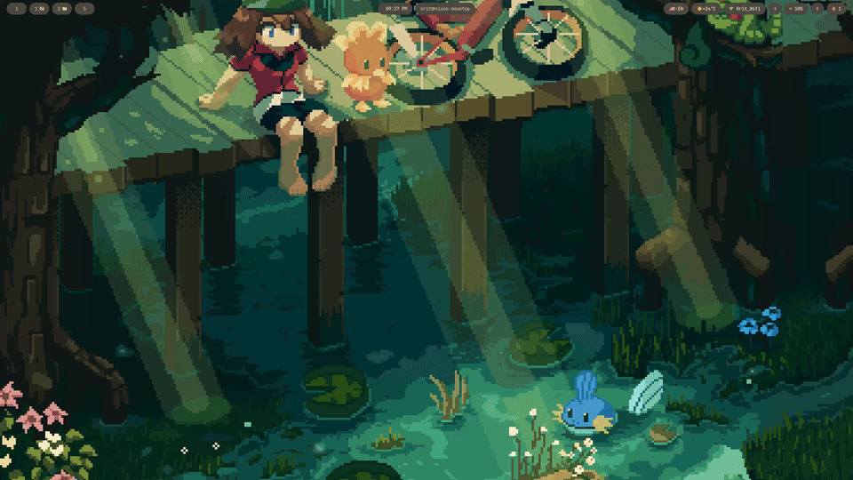

# ❄️ Personal NixOS Config



---

## ✨ Features

→ [Full feature descriptions](./Documentation/features.md)

- Modular config via denix (modules and per-host constants)
- Home-manager modules (`/modules/nixos`) and manual-import templates (`/templates`)
- Hybrid declarative + non-declarative modules (shells, caelestia, noctalia)
- Theming: base16 + optional Catppuccin via stylix
- Wallpapers tied to the monitor list
- Multiple desktop environments: Hyprland with waybar, Hyprland with caelestia, Hyprland with noctalia, niri with noctalia, MangoWM with mangowc, KDE, GNOME, Cosmic
- NixOS specializations: guest (ephemeral RAM home), safe-mode (IceWM recovery shell), deep-focus (distraction-free workspaces), secure-travel (hardened, kill-switch VPN)
- flakes & Home Manager integration
- Multiple shells (bash, zsh, fish)
- Optional BTRFS snapshots with a configurable retention policy
- Cachix binary cache support
- Architecture: `x86_64-linux` (the laptop). `aarch64-linux` is only evaluation-tested, best-effort - no physical aarch64-linux hardware available

---

## 🚀 Installation

### Common Steps (both methods)

1. Boot a **NixOS Minimal ISO** from a USB stick (UEFI, Secure Boot off).
2. Connect to the internet (`sudo nmtui` for WiFi).
3. Download the config:
   <!-- TODO: fix the clone URL later -->
   ```bash
   nix-shell -p git
   git clone https://github.com/nicolkrit999/nix.git
   cd ~/nix
   ```
4. Follow the guide below.

### Choose Your Installation Method

| Method | Guide |
|--------|-------|
| **Disko** (recommended) | [Installation with disko](./Documentation/installation/disko.md) |
| **Manual** (custom partitioning) | [Manual installation](./Documentation/installation/manual.md) |

> You set the password for user `pierre` right after the install, with `nixos-enter` (see the last install step of the guide you follow). The config contains no initial password.

---

## 🔄 Daily Usage

→ [Daily usage guide](./Documentation/daily-usage.md)

| Alias | Description |
|-------|-------------|
| `sw` | Rebuild everything |
| `upd` | Update flake inputs and rebuild |

---

## ❓ Troubleshooting

→ [Troubleshooting guides](./Documentation/troubleshooting/)

**Quick reference:**

- `path '.../hardware-configuration.nix' does not exist` → `git add -f hosts/nixos-laptop/hardware-configuration.nix`
- `permission denied` on `flake.lock` → `sudo chown -R $USER:users ~/nix`
- `returned non-zero exit status 4` → usually a service restart failure after a successful build; try rebuilding again
- Weird keyboard layout during install → `loadkeys <layout>` to fix temporarily
- Caelestia/noctalia font issues → install the font in `configuration.nix` or `home-packages.nix`

---

## 📚 Other Resources

| Resource | Link |
|----------|------|
| Showcase | [showcase.md](./Documentation/showcase.md) |
| Features (in depth) | [features.md](./Documentation/features.md) |
| Denix possibilities | [possibilities.md](./Documentation/usage/denix/possibilities.md) |
| Denix official docs | [denix-official-documentation.pdf](./Documentation/usage/denix/denix-official-documentation.pdf) |
| Binary cache (Cachix) | [cachix.md](./Documentation/usage/cachix/cachix.md) |
| Tmux guide | [tmux-guide.md](./Documentation/usage/tmux/tmux-guide.md) |
| Emergency recovery (GRUB) | [emergency-recovery-gnu-grub.md](./Documentation/troubleshooting/emergency-recovery-gnu-grub.md) |
| Emergency recovery (script) | [recover.sh](./Documentation/troubleshooting/recover.sh) |
| Notes & project origin | [notes.md](./Documentation/notes.md) |
